# ambientCG: Concrete materials

**25 assets from [ambientCG](https://ambientcg.com), dedicated to the public domain under [CC0](https://docs.ambientcg.com/license/).** Use them in any game, free or paid, and change them however you like; no credit is needed.

PBR materials as 1K and 2K JPG maps (colour, normal GL and DX, roughness, AO, displacement), one folder per resolution. 882.7 MB in all.

This is a copy kept by [zuujis-cc0](https://github.com/zuujis-cc0) so game makers can take single files from GitHub. It is not made by or affiliated with ambientCG: the originals, often in more formats and higher resolutions, are on [ambientcg.com](https://ambientcg.com). If they help you, consider [supporting ambientCG](https://www.patreon.com/ambientCG).

Every file is listed in [MANIFEST.tsv](MANIFEST.tsv) with its size and SHA-256. More free assets: [the Zuujis collection](https://github.com/zuujis-cc0/free-game-assets#readme).

| | | | |
| :-: | :-: | :-: | :-: |
| <a href="Concrete027">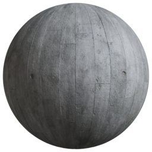</a> <b><a href="Concrete027">Concrete 027</a></b> by ambientCG · <a href="https://ambientcg.com/a/Concrete027">source</a> | <a href="Concrete028">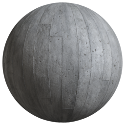</a> <b><a href="Concrete028">Concrete 028</a></b> by ambientCG · <a href="https://ambientcg.com/a/Concrete028">source</a> | <a href="Concrete029">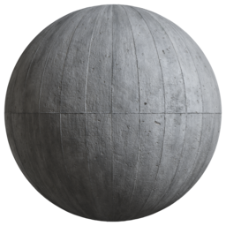</a> <b><a href="Concrete029">Concrete 029</a></b> by ambientCG · <a href="https://ambientcg.com/a/Concrete029">source</a> | <a href="Concrete030">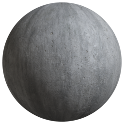</a> <b><a href="Concrete030">Concrete 030</a></b> by ambientCG · <a href="https://ambientcg.com/a/Concrete030">source</a> |
| <a href="Concrete031">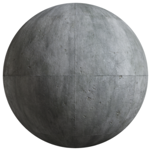</a> <b><a href="Concrete031">Concrete 031</a></b> by ambientCG · <a href="https://ambientcg.com/a/Concrete031">source</a> | <a href="Concrete032">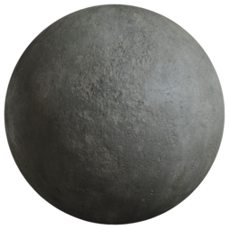</a> <b><a href="Concrete032">Concrete 032</a></b> by ambientCG · <a href="https://ambientcg.com/a/Concrete032">source</a> | <a href="Concrete033">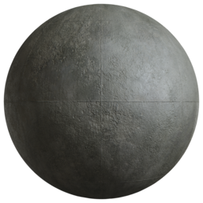</a> <b><a href="Concrete033">Concrete 033</a></b> by ambientCG · <a href="https://ambientcg.com/a/Concrete033">source</a> | <a href="Concrete034">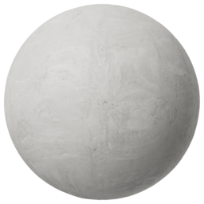</a> <b><a href="Concrete034">Concrete 034</a></b> by ambientCG · <a href="https://ambientcg.com/a/Concrete034">source</a> |
| <a href="Concrete035">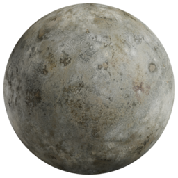</a> <b><a href="Concrete035">Concrete 035</a></b> by ambientCG · <a href="https://ambientcg.com/a/Concrete035">source</a> | <a href="Concrete036">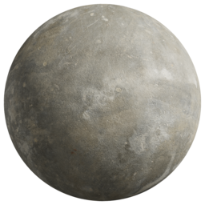</a> <b><a href="Concrete036">Concrete 036</a></b> by ambientCG · <a href="https://ambientcg.com/a/Concrete036">source</a> | <a href="Concrete037">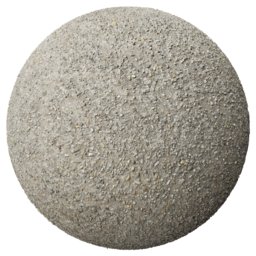</a> <b><a href="Concrete037">Concrete 037</a></b> by ambientCG · <a href="https://ambientcg.com/a/Concrete037">source</a> | <a href="Concrete038">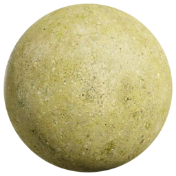</a> <b><a href="Concrete038">Concrete 038</a></b> by ambientCG · <a href="https://ambientcg.com/a/Concrete038">source</a> |
| <a href="Concrete039">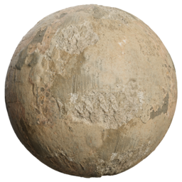</a> <b><a href="Concrete039">Concrete 039</a></b> by ambientCG · <a href="https://ambientcg.com/a/Concrete039">source</a> | <a href="Concrete040">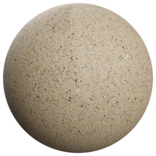</a> <b><a href="Concrete040">Concrete 040</a></b> by ambientCG · <a href="https://ambientcg.com/a/Concrete040">source</a> | <a href="Concrete041A">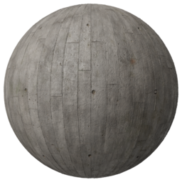</a> <b><a href="Concrete041A">Concrete 041 A</a></b> by ambientCG · <a href="https://ambientcg.com/a/Concrete041A">source</a> | <a href="Concrete041B">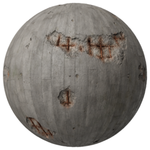</a> <b><a href="Concrete041B">Concrete 041 B</a></b> by ambientCG · <a href="https://ambientcg.com/a/Concrete041B">source</a> |
| <a href="Concrete041C">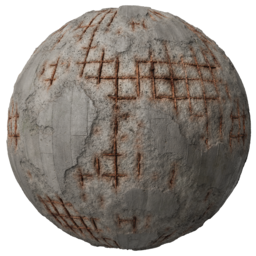</a> <b><a href="Concrete041C">Concrete 041 C</a></b> by ambientCG · <a href="https://ambientcg.com/a/Concrete041C">source</a> | <a href="Concrete041D">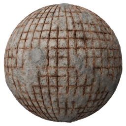</a> <b><a href="Concrete041D">Concrete 041 D</a></b> by ambientCG · <a href="https://ambientcg.com/a/Concrete041D">source</a> | <a href="Concrete042A">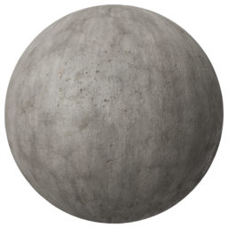</a> <b><a href="Concrete042A">Concrete 042 A</a></b> by ambientCG · <a href="https://ambientcg.com/a/Concrete042A">source</a> | <a href="Concrete042B">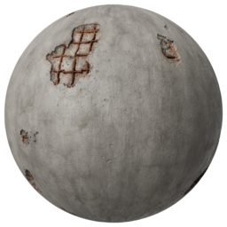</a> <b><a href="Concrete042B">Concrete 042 B</a></b> by ambientCG · <a href="https://ambientcg.com/a/Concrete042B">source</a> |
| <a href="Concrete042C">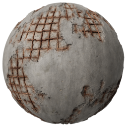</a> <b><a href="Concrete042C">Concrete 042 C</a></b> by ambientCG · <a href="https://ambientcg.com/a/Concrete042C">source</a> | <a href="Concrete042D">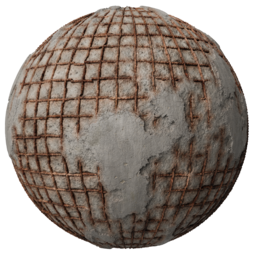</a> <b><a href="Concrete042D">Concrete 042 D</a></b> by ambientCG · <a href="https://ambientcg.com/a/Concrete042D">source</a> | <a href="Concrete043A">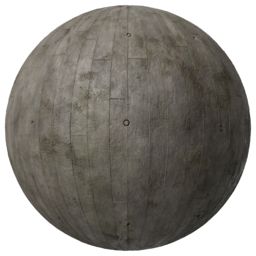</a> <b><a href="Concrete043A">Concrete 043 A</a></b> by ambientCG · <a href="https://ambientcg.com/a/Concrete043A">source</a> | <a href="Concrete043B">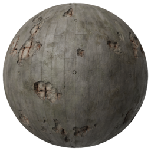</a> <b><a href="Concrete043B">Concrete 043 B</a></b> by ambientCG · <a href="https://ambientcg.com/a/Concrete043B">source</a> |
| <a href="Concrete043C">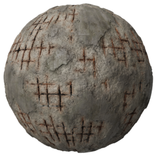</a> <b><a href="Concrete043C">Concrete 043 C</a></b> by ambientCG · <a href="https://ambientcg.com/a/Concrete043C">source</a> |  |  |  |

---

Kept up to date by this repository's own [update workflow](.github/workflows/update.yml), with code and plan from [cc0-mirror](https://github.com/zuujis-cc0/cc0-mirror). Something wrong? [Open an issue there](https://github.com/zuujis-cc0/cc0-mirror/issues/new) or use the [private report form](https://games.zuujis.com/report).
